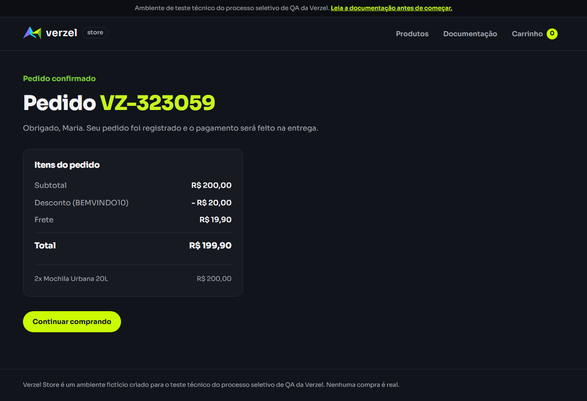

# Evidência dos cenários de frete em R$ 200,00

Data da execução: 08/10/2026  
Navegador: Chromium  
Ambiente: `https://verzel-store.qa-test-verzel-store.workers.dev`

## Cenário 1 — Conceder frete grátis exatamente em duzentos reais

### Dados utilizados

- Produto: 2 unidades de Mochila Urbana 20L
- Preço unitário: R$ 100,00
- Cupom: nenhum

### Resultado esperado e obtido

| Verificação | Esperado | Obtido | Resultado |
| --- | --- | --- | --- |
| Subtotal | R$ 200,00 | R$ 200,00 | Passou |
| Frete | Grátis | R$ 19,90 | **Falhou** |
| Total | R$ 200,00 | R$ 219,90 | **Falhou** |
| Mensagem de valor faltante | Não exibida | “Faltam R$ 0,00 para o frete grátis.” | **Falhou** |

Conclusão: **cenário reprovado**. O comportamento reproduz o BUG-001.

## Cenário 2 — Preservar frete grátis em duzentos reais após aplicar cupom

### Dados utilizados

- Produto: 2 unidades de Mochila Urbana 20L
- Subtotal: R$ 200,00
- Cupom: `BEMVINDO10`
- Cliente fictício: dados válidos de teste

### Resultado no carrinho

| Verificação | Esperado | Obtido | Resultado |
| --- | --- | --- | --- |
| Subtotal | R$ 200,00 | R$ 200,00 | Passou |
| Desconto | R$ 20,00 | R$ 20,00 | Passou |
| Frete | Grátis | R$ 19,90 | **Falhou** |
| Total | R$ 180,00 | R$ 199,90 | **Falhou** |
| Mensagem de valor faltante | Não exibida | “Faltam R$ 0,00 para o frete grátis.” | **Falhou** |

### Resultado após confirmar o pedido

| Verificação | Esperado | Obtido | Resultado |
| --- | --- | --- | --- |
| Desconto confirmado | R$ 20,00 | R$ 20,00 | Passou |
| Frete confirmado | Grátis | R$ 19,90 | **Falhou** |
| Total confirmado | R$ 180,00 | R$ 199,90 | **Falhou** |

Conclusão: **cenário reprovado**. O desconto é calculado corretamente, mas o frete indevido é preservado na confirmação do pedido. Isso confirma que o BUG-001 está na regra de cálculo utilizada pela API, e não apenas na apresentação do carrinho.

## Evidência visual



- [Abrir a captura da confirmação](cenarios-frete-200-confirmacao.png)

## Automação E2E

Os dois cenários foram incorporados à suíte Playwright:

- `UI-02`: `tests/e2e/cart.e2e.spec.ts`;
- `UI-12`: `tests/e2e/checkout.e2e.spec.ts`;
- Page Object da confirmação: `tests/pages/order-confirmation.page.ts`.

Comando executado:

```powershell
.\node_modules\.bin\playwright.cmd test --project=e2e-chromium --workers=1 --grep "frete grátis.*R\$ 200,00|preserva frete grátis"
```

Resultado: **2 testes executados e 2 testes reprovados pelo BUG-001**. As verificações suaves permitiram coletar todas as divergências do carrinho e da confirmação em uma única execução.
