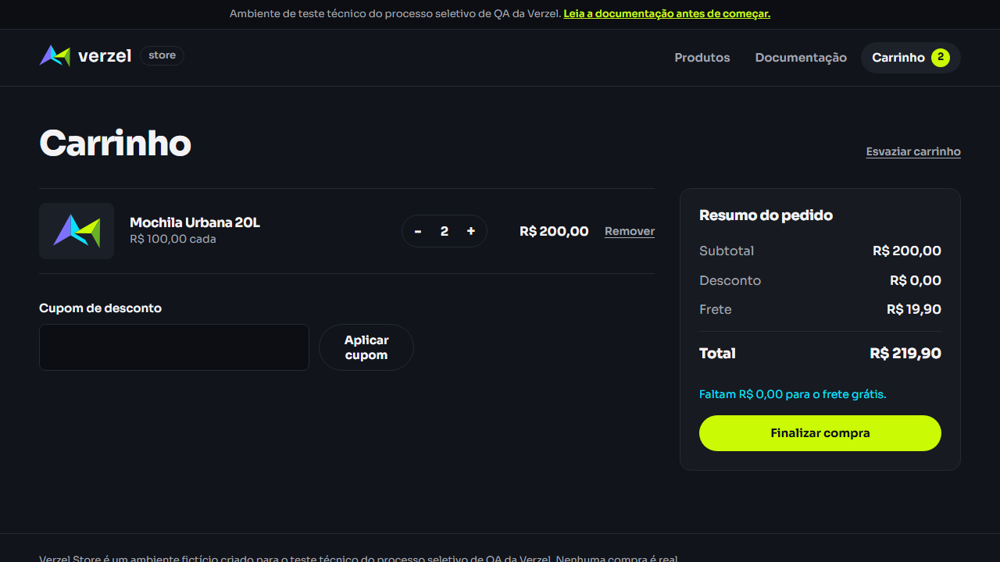

# Evidências da execução

Execução de referência: **EXE-2026-10-09-04**  
Data: **09/10/2026**  
Ambiente: `https://verzel-store.qa-test-verzel-store.workers.dev`

## Resultado consolidado

- 42 execuções automatizadas aceitas pelo runner: 36 aprovações normais e 6 falhas esperadas.
- 29 cenários automatizados únicos: 16 de API e 13 E2E.
- Os 13 cenários E2E foram executados no Chromium e no Google Chrome.
- 8 observações manuais/exploratórias assistidas: 7 passaram e 1 falhou.
- Nenhuma falha inesperada; as 6 falhas esperadas correspondem a 2 bugs distintos: BUG-001 e BUG-002.

## Evidência visual do BUG-001

No subtotal de R$ 200,00, a tela mostra frete de R$ 19,90, total de R$ 219,90 e a mensagem “Faltam R$ 0,00 para o frete grátis”. As capturas abaixo foram preservadas como evidências permanentes dos dois navegadores configurados.

### Chromium



- [Abrir screenshot sem cupom](evidencias/2026-10-09/BUG-001/ui-chromium-carrinho/test-failed-1.png)
- [Abrir vídeo sem cupom](evidencias/2026-10-09/BUG-001/ui-chromium-carrinho/video.webm)
- [Abrir contexto sem cupom](evidencias/2026-10-09/BUG-001/ui-chromium-carrinho/error-context.md)
- [Abrir screenshot com cupom](evidencias/2026-10-09/BUG-001/ui-chromium-checkout/test-failed-1.png)
- [Abrir vídeo com cupom](evidencias/2026-10-09/BUG-001/ui-chromium-checkout/video.webm)
- [Abrir contexto com cupom](evidencias/2026-10-09/BUG-001/ui-chromium-checkout/error-context.md)

### Google Chrome


- [Abrir screenshot sem cupom](evidencias/2026-10-09/BUG-001/ui-chrome-carrinho/test-failed-1.png)
- [Abrir vídeo sem cupom](evidencias/2026-10-09/BUG-001/ui-chrome-carrinho/video.webm)
- [Abrir contexto sem cupom](evidencias/2026-10-09/BUG-001/ui-chrome-carrinho/error-context.md)
- [Abrir screenshot com cupom](evidencias/2026-10-09/BUG-001/ui-chrome-checkout/test-failed-1.png)
- [Abrir vídeo com cupom](evidencias/2026-10-09/BUG-001/ui-chrome-checkout/video.webm)
- [Abrir contexto com cupom](evidencias/2026-10-09/BUG-001/ui-chrome-checkout/error-context.md)

## Evidências da API

| Bug | Evidência |
| --- | --- |
| BUG-001 — frete no limite | [`BUG-001/api/error-context.md`](evidencias/2026-10-09/BUG-001/api/error-context.md) |
| BUG-002 — quantidade maior que cinco | [`BUG-002/api/error-context.md`](evidencias/2026-10-09/BUG-002/api/error-context.md) |

Os payloads, respostas reais, resultados esperados e impactos estão detalhados no [relatório de bugs](bug-report.md).

## Evidências da sessão exploratória

- [Resultado bruto em JSON](evidencias/2026-10-09/exploratory/session-results.json)
- [Screenshot do limite de frete](evidencias/2026-10-09/exploratory/frete-no-limite.png)
- [Resultado dos dois cenários de frete em R$ 200,00](evidencias/2026-10-08/exploratory/cenarios-frete-200.md)
- [Screenshot do pedido confirmado com cupom e frete indevido](evidencias/2026-10-08/exploratory/cenarios-frete-200-confirmacao.png)
- Script reproduzível: [`scripts/exploratory-session.cjs`](../scripts/exploratory-session.cjs)

## Relatório HTML do Playwright

O relatório navegável da execução mais recente está em:

```text
playwright-report/index.html
```

Para abri-lo:

```powershell
npm.cmd run report
```

## Evidências temporárias e permanentes

- `test-results/` e `playwright-report/` são regenerados em novas execuções.
- `docs/evidencias/2026-10-09/` contém as cópias preservadas da execução atual.
- `docs/evidencias/2026-10-08/` mantém evidências históricas complementares.
- Screenshots, vídeos e traces configurados no runner são mantidos para falhas inesperadas; as evidências de bugs conhecidos ficam preservadas em `docs/evidencias/`.
